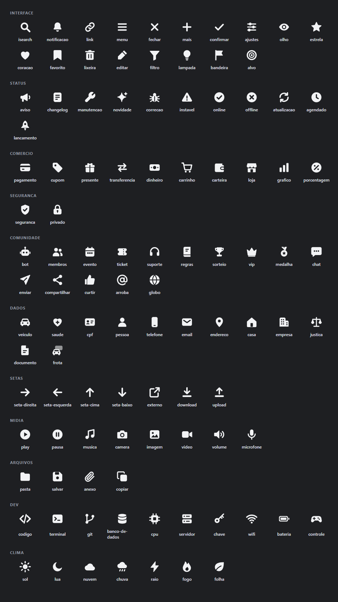
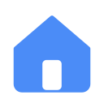
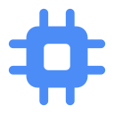
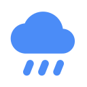

# awesome-icons

Ícones sólidos de 24px com recortes, no mesmo estilo dos ícones do isearch. Funcionam bem em Discord, painéis e apps escuros.

**104 ícones** em 4 cores: `cinza` `#b5bac1`, `branco` `#f2f3f5`, `azul` `#4b8cf7` e `preto` `#1e1f22`, cada um em SVG e em PNG de 128px.



## Como usar

- SVG: `svg/<cor>/<nome>.svg`
- PNG 128px: `png/<cor>/<nome>.png`
- Emoji no Discord: suba o PNG em Configurações do servidor > Emoji.

## Como funciona

Cada ícone fica em [`icones.mjs`](icones.mjs) como `[nome, categoria, forma, máscara]`:

- `forma` é preenchida com a cor do ícone.
- `máscara` são as áreas em preto recortadas da forma. É isso que dá os furos (o check dentro do círculo, as linhas do documento).
- A grade é 24x24, desenhada com `viewBox="-1 -1 26 26"` para sobrar 1px de margem.

Para adicionar um ícone, inclua uma linha em `icones.mjs` e rode:

```bash
npm install
npm run gera
```

O script gera `svg/`, `png/` e `folha.png`, e atualiza as tabelas abaixo. Ele usa o Chrome instalado; se o Chrome estiver em outro caminho, defina a variável `CHROME`.

## Ícones

<!-- icones -->
### interface (18)

| | | | | | |
| :-: | :-: | :-: | :-: | :-: | :-: |
| <br><sub>isearch</sub> | <br><sub>notificacao</sub> | <br><sub>link</sub> | <br><sub>menu</sub> | <br><sub>fechar</sub> | <br><sub>mais</sub> |
| <br><sub>confirmar</sub> | <br><sub>ajustes</sub> | <br><sub>olho</sub> | <br><sub>estrela</sub> | <br><sub>coracao</sub> | <br><sub>favorito</sub> |
| <br><sub>lixeira</sub> | <br><sub>editar</sub> | <br><sub>filtro</sub> | <br><sub>lampada</sub> | <br><sub>bandeira</sub> | <br><sub>alvo</sub> |

### status (11)

| | | | | | |
| :-: | :-: | :-: | :-: | :-: | :-: |
| <br><sub>aviso</sub> | <br><sub>changelog</sub> | <br><sub>manutencao</sub> | <br><sub>novidade</sub> | <br><sub>correcao</sub> | <br><sub>instavel</sub> |
| <br><sub>online</sub> | <br><sub>offline</sub> | <br><sub>atualizacao</sub> | <br><sub>agendado</sub> | <br><sub>lancamento</sub> |

### comercio (10)

| | | | | | |
| :-: | :-: | :-: | :-: | :-: | :-: |
| <br><sub>pagamento</sub> | <br><sub>cupom</sub> | <br><sub>presente</sub> | <br><sub>transferencia</sub> | <br><sub>dinheiro</sub> | <br><sub>carrinho</sub> |
| <br><sub>carteira</sub> | <br><sub>loja</sub> | <br><sub>grafico</sub> | <br><sub>porcentagem</sub> |

### seguranca (2)

| | |
| :-: | :-: |
| <br><sub>seguranca</sub> | <br><sub>privado</sub> |

### comunidade (15)

| | | | | | |
| :-: | :-: | :-: | :-: | :-: | :-: |
| <br><sub>bot</sub> | <br><sub>membros</sub> | <br><sub>evento</sub> | <br><sub>ticket</sub> | <br><sub>suporte</sub> | <br><sub>regras</sub> |
| <br><sub>sorteio</sub> | <br><sub>vip</sub> | <br><sub>medalha</sub> | <br><sub>chat</sub> | <br><sub>enviar</sub> | <br><sub>compartilhar</sub> |
| <br><sub>curtir</sub> | <br><sub>arroba</sub> | <br><sub>globo</sub> |

### dados (12)

| | | | | | |
| :-: | :-: | :-: | :-: | :-: | :-: |
| <br><sub>veiculo</sub> | <br><sub>saude</sub> | <br><sub>cpf</sub> | <br><sub>pessoa</sub> | <br><sub>telefone</sub> | <br><sub>email</sub> |
| <br><sub>endereco</sub> | <br><sub>casa</sub> | <br><sub>empresa</sub> | <br><sub>justica</sub> | <br><sub>documento</sub> | <br><sub>frota</sub> |

### setas (7)

| | | | | | |
| :-: | :-: | :-: | :-: | :-: | :-: |
| <br><sub>seta-direita</sub> | <br><sub>seta-esquerda</sub> | <br><sub>seta-cima</sub> | <br><sub>seta-baixo</sub> | <br><sub>externo</sub> | <br><sub>download</sub> |
| <br><sub>upload</sub> |

### midia (8)

| | | | | | |
| :-: | :-: | :-: | :-: | :-: | :-: |
| <br><sub>play</sub> | <br><sub>pausa</sub> | <br><sub>musica</sub> | <br><sub>camera</sub> | <br><sub>imagem</sub> | <br><sub>video</sub> |
| <br><sub>volume</sub> | <br><sub>microfone</sub> |

### arquivos (4)

| | | | |
| :-: | :-: | :-: | :-: |
| <br><sub>pasta</sub> | <br><sub>salvar</sub> | <br><sub>anexo</sub> | <br><sub>copiar</sub> |

### dev (10)

| | | | | | |
| :-: | :-: | :-: | :-: | :-: | :-: |
| <br><sub>codigo</sub> | <br><sub>terminal</sub> | <br><sub>git</sub> | <br><sub>banco-de-dados</sub> | <br><sub>cpu</sub> | <br><sub>servidor</sub> |
| <br><sub>chave</sub> | <br><sub>wifi</sub> | <br><sub>bateria</sub> | <br><sub>controle</sub> |

### clima (7)

| | | | | | |
| :-: | :-: | :-: | :-: | :-: | :-: |
| <br><sub>sol</sub> | <br><sub>lua</sub> | <br><sub>nuvem</sub> | <br><sub>chuva</sub> | <br><sub>raio</sub> | <br><sub>fogo</sub> |
| <br><sub>folha</sub> |
<!-- /icones -->

## Licença

MIT
